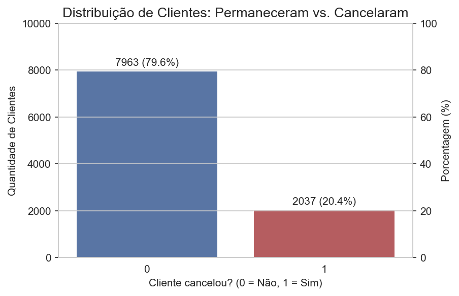
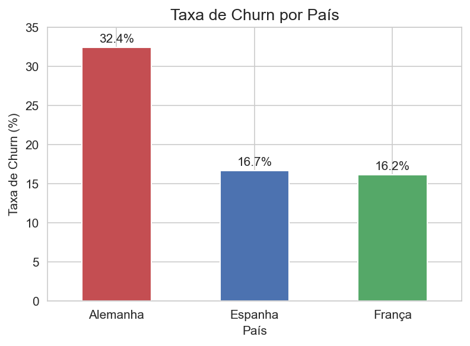
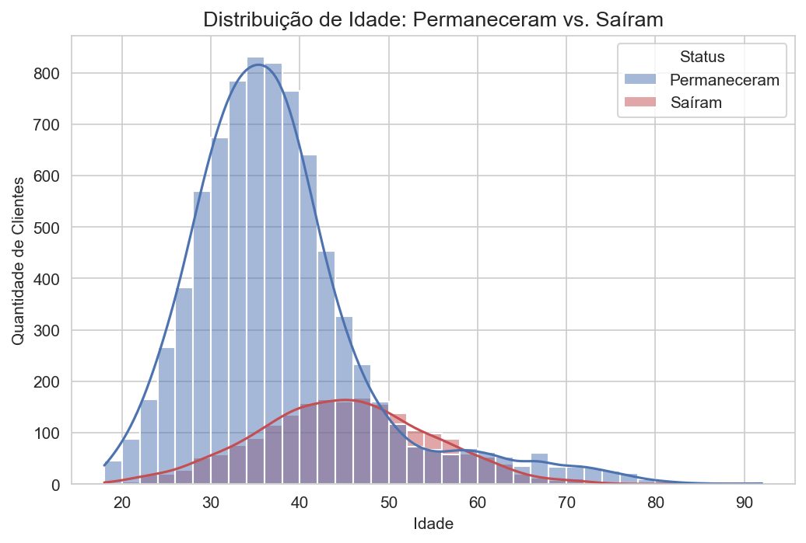
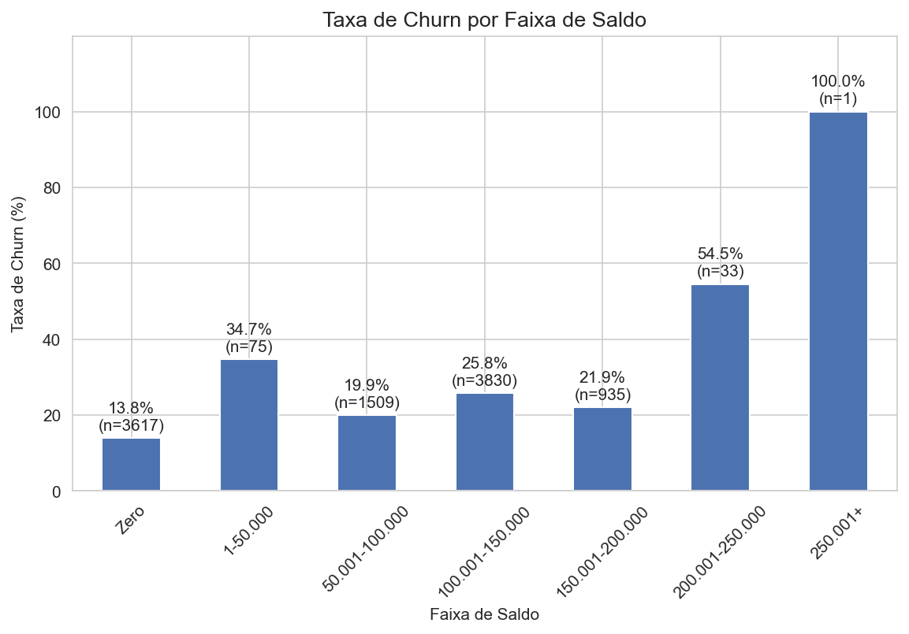
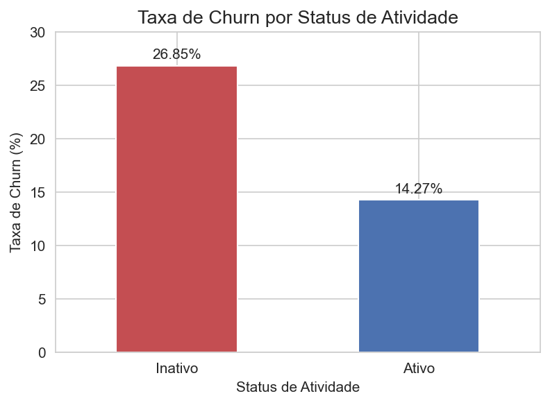
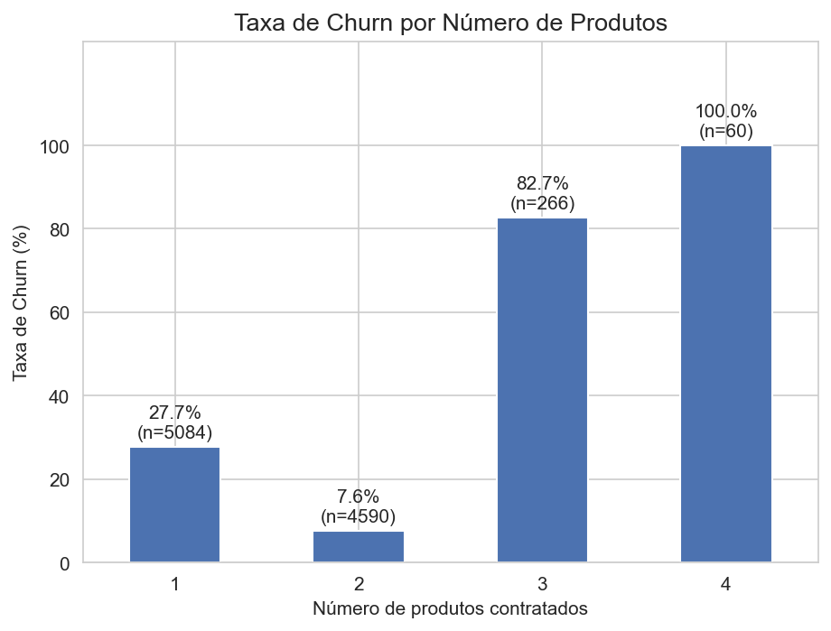

# Análise de Churn de Clientes Bancários

Análise exploratória de dados (EDA) em Python para entender **quais perfis de clientes mais cancelam o relacionamento com um banco** e o que a instituição poderia fazer a respeito.

## Resumo dos resultados

Dos 10.000 clientes analisados, **20,4% cancelaram** (2.037 clientes), ou seja, cerca de 1 em cada 5. O cancelamento não se distribui de forma uniforme:

- **País:** a Alemanha tem churn de 32,4%, o dobro de França (16,2%) e Espanha (16,7%).
- **Gênero:** mulheres cancelam mais que homens (25,1% contra 16,5%).
- **Idade:** o risco cresce a partir dos 40 anos e chega a **56,6% entre 50 e 58 anos**, quase o triplo da taxa geral.
- **Atividade:** clientes inativos cancelam quase o dobro dos ativos (26,85% contra 14,27%).
- **Produtos:** clientes com apenas 1 produto concentram cerca de **69% de todas as saídas** (27,7% de churn); quem tem 2 produtos cancela apenas 7,6%.
- **Sem relação clara:** score de crédito e tempo de relacionamento com o banco.

## Dados

- **Fonte:** [Bank Customer Churn Prediction (Kaggle)](https://www.kaggle.com/datasets/shantanudhakadd/bank-customer-churn-prediction), arquivo `Churn_Modelling.csv`.
- **Tamanho:** 10.000 clientes de 3 países (França, Alemanha e Espanha), sem valores nulos e sem linhas duplicadas.
- **Variável alvo:** `Exited` (1 = cancelou, 0 = permaneceu).
- **Variáveis analisadas:** país, gênero, idade, score de crédito, saldo, atividade, tempo de relacionamento e número de produtos.
- As colunas `RowNumber`, `CustomerId` e `Surname` foram removidas por serem apenas identificadores, sem valor analítico.

## Perguntas e principais achados

### Visão geral

**1. Qual a taxa de churn geral?**



20,4% dos clientes cancelaram. Essa taxa serve de referência para todas as análises seguintes: grupos acima dela representam risco elevado, e grupos abaixo indicam maior fidelização.

### Perfil demográfico

**2. O churn está concentrado em algum país?**



Sim. A Alemanha se destaca com 32,4%, enquanto França e Espanha ficam bem próximas entre si, em torno de 16%. Isso sugere que fatores específicos do mercado alemão podem estar afetando a retenção.

**3. O gênero ou a idade influenciam no churn?**

Gênero: mulheres têm taxa de churn de 25,1%, contra 16,5% dos homens.

Idade: a base é formada majoritariamente por clientes de 30 a 40 anos, mas o churn se concentra de 40 a 50 anos. Entre 50 e 58 anos, o número de clientes que saíram supera o dos que permaneceram, com taxa de 56,6%.




### Perfil financeiro

**4. O score de crédito tem impacto sobre o churn?**

Não de forma relevante. Boxplot e histograma mostram distribuições muito parecidas entre quem ficou e quem saiu. Os únicos destaques são 19 clientes com score abaixo de 400, todos do grupo que cancelou, mas eles representam apenas 0,19% da base.

**5. Clientes com saldo mais alto tendem a sair do banco?**



A relação não é linear. 36,2% dos clientes têm saldo zero e esse grupo tem a menor taxa de churn (13,8%), provavelmente por serem contas pouco ativas. Entre os clientes com saldo positivo, a taxa sobe de 19,9% (50 a 100 mil) para 25,8% (100 a 150 mil), a faixa com mais clientes e mais cancelamentos, e recua para 21,9% (150 a 200 mil).

> **Atenção:** as faixas de 1 a 50 mil (75 clientes) e acima de 200 mil (34 clientes) têm amostras pequenas, por isso o gráfico mostra o `n` de cada barra. Essas taxas não sustentam conclusões.

### Comportamento e engajamento

**6. Clientes inativos têm maior probabilidade de cancelar?**



Sim: 26,85% de churn entre inativos contra 14,27% entre ativos. Diferente de idade ou país, o engajamento é algo sobre o qual o banco pode agir diretamente.

**7. Como é o churn conforme o tempo de relacionamento?**

Sem relação clara. A taxa varia apenas entre 17,2% e 23,0% ao longo dos 11 anos analisados, sempre próxima da média geral de 20,4%. A fidelidade não cresce automaticamente com o tempo de casa.

**8. Clientes com mais produtos cancelam menos?**



Apenas em parte. Clientes com 2 produtos são os mais fiéis (7,6%), e os de 1 produto cancelam mais (27,7%) e concentram cerca de 69% das saídas. Já os clientes com 3 e 4 produtos têm taxas muito altas (82,7% e 100%), mas somam só 3,3% da base e cerca de 14% das saídas, resultado que merece investigação própria.

## Recomendações

- **Reengajar clientes inativos**, o grupo de maior risco sobre o qual o banco pode agir diretamente, com campanhas de reativação.
- **Priorizar clientes com 1 produto**, onde está o maior volume de perdas, testando a oferta de um segundo produto em um teste controlado (a análise mostra associação, não causa).
- **Investigar os grupos de maior intensidade de churn**: mercado alemão, faixa de 50 a 58 anos e clientes com 3 ou 4 produtos.

## Limitações

- As variáveis foram analisadas uma a uma, sem cruzamentos entre elas.
- Os resultados mostram associações, não relações de causa e efeito.
- O dataset é público e não há informação sobre como foi coletado, então os resultados podem não refletir a realidade de um banco específico.
- Grupos pequenos foram tratados com cautela e sinalizados ao longo da análise.

## Tecnologias

Python, pandas, NumPy, Matplotlib, Seaborn e Jupyter Notebook.

## Como executar

1. Clone este repositório.
2. Baixe o arquivo `Churn_Modelling.csv` pelo [link do Kaggle](https://www.kaggle.com/datasets/shantanudhakadd/bank-customer-churn-prediction) e salve na mesma pasta do notebook.
3. Instale as dependências:
   ```bash
   pip install pandas numpy matplotlib seaborn jupyter
   ```
4. Abra o notebook e execute todas as células:
   ```bash
   jupyter notebook Projeto_Analise_Churn.ipynb
   ```

## Estrutura do repositório

```
├── Projeto_Analise_Churn.ipynb   # análise completa, com insights e checkpoints
├── images/                       # gráficos usados neste README
└── README.md
```

## Próximos passos

- Cruzar as variáveis mais relevantes (por exemplo, gênero × idade e país × atividade).
- Treinar um modelo de classificação para medir o peso de cada fator na previsão do churn, o que será feito em um projeto seguinte, de risco de crédito.

## Autor

**Alexander Theophilo** · [LinkedIn](https://www.linkedin.com/in/alexander-theophilo/) · [GitHub](https://github.com/Alex-Theophilo)
